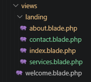
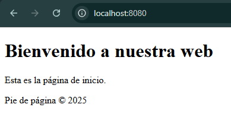
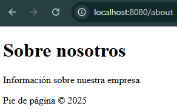
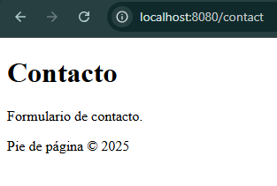
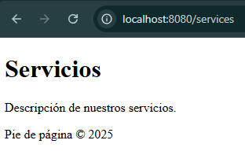

# Tema XX: [Título del tema]

| | |
|---|---|
| **Fecha de inicio** | 23/11/2026 |
| **Fecha de fin** | dd/mm/aaaa |
| **Tiempo dedicado** | 1 horas |
| **Rama de Git** | `tema02` |

---

## 1. 🎯 Objetivo del tema

<!-- Explica con TUS palabras qué había que conseguir en este tema (2-4 líneas).
     No copies el enunciado. -->

---

## 2. 🛠️ Desarrollo paso a paso

<!-- Un apartado por cada paso importante. Para cada uno:
     - Qué haces y POR QUÉ.
     - El comando o el código, en un bloque de código (nunca como captura).
     - Una captura solo si aporta algo visual (navegador, resultado, estructura...). -->
    

### 2.1 Creación de páginas HTML completas

Vamos a comenzar por crear varias páginas HTML básicas con todo su código HTML. Más adelante veremos cómo optimizar el código usando layouts, partials y componentes.

Vamos a crear 4 páginas básicas en resources/views/landing/:

- index.blade.php: página de inicio
- about.blade.php: Página típica about, datos de la empresa
- services.blade.php: Página con los servicios que ofrece la empresa
- contact.blade.php: Página de contacto

**index.blade.php**
```php
<!DOCTYPE html>
<html lang="es">
<head>
    <meta charset="UTF-8">
    <title>Inicio</title>    
</head>
<body>
    <header>
        <h1>Bienvenido a nuestra web</h1>
    </header>

    <main>
        <p>Esta es la página de inicio.</p>
    </main>

    <footer>
        <p>Pie de página &copy; 2025</p>
    </footer>
</body>
</html>
```
***
**about.blade.php**
```php
<!DOCTYPE html>
<html lang="es">
<head>
    <meta charset="UTF-8">
    <title>Sobre nosotros</title>
</head>
<body>
    <header>
        <h1>Sobre nosotros</h1>
    </header>

    <main>
        <p>Información sobre nuestra empresa.</p>
    </main>

    <footer>
        <p>Pie de página &copy; 2025</p>
    </footer>
</body>
</html>
```
***
**services.blase.php**
```php
<!DOCTYPE html>
<html lang="es">
<head>
    <meta charset="UTF-8">
    <title>Servicios</title>
</head>
<body>
    <header>
        <h1>Servicios</h1>
    </header>

    <main>
        <p>Descripción de nuestros servicios.</p>
    </main>

    <footer>
        <p>Pie de página &copy; 2025</p>
    </footer>
</body>
</html>
```
***
**contact.blade.php**
```php
<!DOCTYPE html>
<html lang="es">
<head>
    <meta charset="UTF-8">
    <title>Contacto</title>
</head>
<body>
    <header>
        <h1>Contacto</h1>
    </header>

    <main>
        <p>Formulario de contacto.</p>
    </main>

    <footer>
        <p>Pie de página &copy; 2025</p>
    </footer>
</body>
</html>
```
***
**Distribución de carpetas**



### 2.2 Definir las rutas

**routes/web.php**
```php
<?php
Route::view('/', 'landing.index')->name('home');
Route::view('/about', 'landing.about')->name('about');
Route::view('/services', 'landing.services')->name('services');
Route::view('/contact', 'landing.contact')->name('contact');
```
*Probando rutas*
---

**localhost:8080**'



**localhost:8080/about**



**localhost:8080/contact**



**localhost:8080/services**



---
### 2.3 Creación de un Layout base
Creamos la carpeta layout en `resources/views/landing/aquí`

Creo dentro de `/layout/` **landing.blade.php**
```php
<!DOCTYPE html>
<html lang="es">
<head>
    <meta charset="UTF-8">
    <title>
        @yield('title')
    </title>
</head>
<body>
    <header>
        @yield('header')
    </header>

    <main>
        @yield('content')
    </main>

    <footer>
        <p>Pie de página &copy; 2025</p>
    </footer>
</body>
</html>
``` 
`index.blade.php` *ahora*
```php
@extends('landing.layouts.landing')
@section('title', 'Inicio')
@section('header')
    <h1>Bienvenido a nuestra web</h1>
@endsection
@section('content')
    <p>Esta es la página de inicio.</p>
@endsection
```
`about.blade.php` *ahora*
```php
@extends('landing.layouts.landing')
@section('title', 'Sobre nosotros')
@section('header')
    <h1>Sobre nosotros</h1>
@endsection
@section('content')
    <p>Información sobre nuestra empresa.</p>
@endsection
```

`services.blade.php` *ahora*
```php
@extends('landing.layouts.landing')
@section('title', 'Servicios')
@section('header')
    <h1>Servicios</h1>
@endsection
@section('content')
    <p>Descripción de nuestros servicios.</p>
@endsection
```
`contact.blade.php` *ahora*
```php
@extends('landing.layouts.landing')
@section('title', 'Contacto')
@section('header')
    <h1>Contacto</h1>
@endsection
@section('content')
    <p>Formulario de contacto.</p>
@endsection
```
___
### 2.4 Añadir un menú de navegación
Añadimos al layout  `layouts/landing.blade.php` el nuevo **header** 

Versión no recomendada
-
```php
<header>
    <nav>
        <ul>
            <li><a href="/">Inicio</a></li>
            <li><a href="/about">Sobre nosotros</a></li>
            <li><a href="/services">Servicios</a></li>
            <li><a href="/contact">Contacto</a></li>
        </ul>
    </nav>
    @yield('header')
</header>
```
Versión recomendada
-
```php
<nav>
    <ul>
        <li><a href="{{ route('home') }}">Inicio</a></li>
        <li><a href="{{ route('about') }}">Sobre nosotros</a></li>
        <li><a href="{{ route('services') }}">Servicios</a></li>
        <li><a href="{{ route('contact') }}">Contacto</a></li>
    </ul>
</nav>
```
### 2.5 Uso de Partials

Creamos una carpeta nueva en `resources/views/` llamada **_partials**

Creamos dentro `nav.blade.php`
-
```php
<nav>
    <ul>
        <li><a href="{{ route('home') }}">Inicio</a></li>
        <li><a href="{{ route('about') }}">Sobre nosotros</a></li>
        <li><a href="{{ route('services') }}">Servicios</a></li>
        <li><a href="{{ route('contact') }}">Contacto</a></li>
    </ul>
</nav>
```

## 3. 📋 Resumen de comandos utilizados

| Comando | Para qué sirve |
|---------|----------------|
| `php artisan ...` | ... |
| `composer ...` | ... |
| `git ...` | ... |

---

## 4. 🐞 Problemas encontrados y soluciones

<!-- Documenta TODOS los problemas, aunque te parezcan tontos.
     Copia el error como texto, no como captura.
     Si no has tenido ningún problema, documenta al menos algo que hayas tenido que investigar. -->

### Problema 1: [Descripción corta]

**Qué estaba haciendo:** ...

**Error:**

```
Pega aquí el mensaje de error completo
```

**Causa:** por qué ocurría (lo que has entendido, no solo lo que has hecho).

**Solución:**

```bash
comando o cambio que lo resolvió
```

**Fuente:** [enlace a la documentación, foro, vídeo...](https://)

### Problema 2: [Descripción corta]

...

---

## 5. ✅ Resultado final

<!-- Captura(s) de la aplicación funcionando al terminar el tema. -->


---

## 6. 💭 Conclusiones

- **Qué he aprendido:** ...
- **Qué me ha costado más:** ...
- **Qué haría diferente / dudas pendientes:** ...
